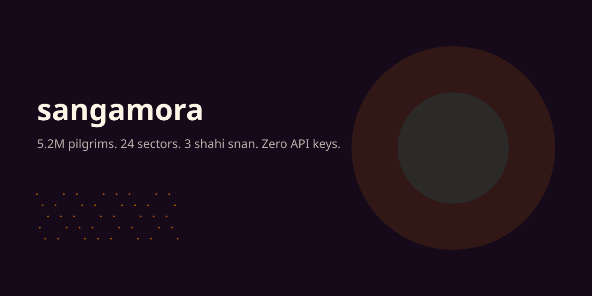
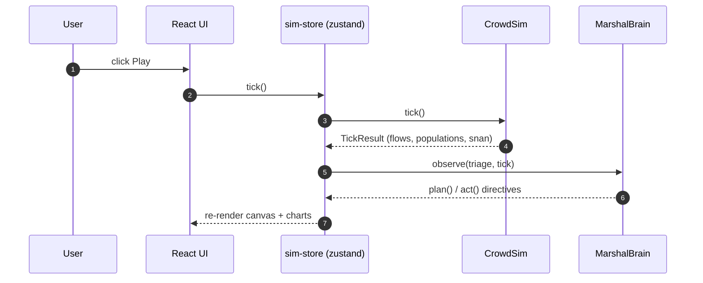

<div align="center">
  
  <h1>sangamora — the widest experience one prompt can build</h1>
  <p>A deterministic, zero-API-key simulation of the Kumbh Mela: 5.2 million pilgrims flow through 24 sectors and 54 edges toward the Triveni Sangam.</p>
  <p>
    
    
    
    
  </p>
  <a href="https://sangamora.vercel.app"><b>Try the live demo →</b></a> · no API keys needed
</div>

---

## What is sangamora?

sangamora is a game-like sandbox of the Kumbh Mela — the world's largest periodic human
gathering. Instead of 5.2 million individual agents (impossible in a browser), pilgrims are
modelled as **mass flowing along capacity-limited edges** between 24 sectors, with mass
conservation exact to the last floating-point ulp. Travel times follow a BPR curve
(alpha 0.15, beta 4), so congestion inflates smoothly and then catastrophically. Risk scores
blend utilization, crush density and stalled time into green / amber / orange / red bands.

On top of the flow engine sits an **emergent bazaar** (336 vendors, price elasticity,
stockouts, Shahi-day spikes), a **deterministic marshal brain** (finite-state, no LLM) that
widens the worst chokes and reverts when a widen backfires, **rail waves** (24 modeled
rakes across 7 days), and a **time machine** whose state hash (FNV-1a) proves
determinism: same seed, same universe, byte for byte.

## What you can do with it

| I want to… | Open | You get |
|---|---|---|
| Watch 5.2M pilgrims flow | `/map` | Live canvas, play/pause, 1×–8× speed, scenario picker |
| See where it crushes | `/risk` | Per-edge utilization, travel time, band chips |
| Poke the economy | `/bazaar` | 336 vendors, prices, stock, cash |
| Watch trains arrive | `/rails` | 24 rakes, cohorts, platforms |
| Inspect sectors | `/sectors` | 24 sector cards with live density meters |
| Replay any minute | `/replay` | Scrubber + FNV-1a state hash |
| Read the calendar | `/calendar` | 7 days, 3 Shahi Snan, weights |
| Chart the run | `/analytics` | Snan count, moved-per-minute |
| Stress-test it | `/scenarios` | 8 presets incl. 11M stress test |
| Learn the domain | `/explainer` | Kumbh, safety, the math |

## Quickstart

```powershell
git clone https://github.com/aniruddhaadak80/sangamora
cd sangamora
bun install
bun run dev          # http://localhost:3000
```

Docker (whole stack — web + Python marshal service + Go relay):

```powershell
docker compose up
```

Run the gates:

```powershell
bun run typecheck
bun run lint
bun run test
bun run build
bun run e2e
```

Polyglot gates:

```powershell
cd services/agents && python -m pytest
cd ../../crates/flow && cargo test
cd ../../services/relay && go test ./...
```

## How it works (the numbered workflow)

1. **Seed** — `MELA_SEED` (default 7331) feeds FNV-1a → mulberry32 → `Rng`.
2. **Build the world** — `CrowdSim` creates 24 sectors, 54 edges, 8 pilgrimage waves
   (Makar Sankranti 0.18, Mauni Amavasya 0.42, Vasant Panchami 0.22).
3. **Tick** — one minute: arrivals inject, flow moves along edges with social friction,
   people reaching Sangam count as snan'd, marshals observe/triage/act/reflect.
4. **Render** — the browser canvas draws sectors as nodes and edges as flows coloured by
   utilization; charts and tables read the same state.
5. **Replay** — `snapshot()` + `stateHash()` (FNV-1a) fingerprint any minute; the hash is
   the proof that two runs with the same seed are byte-identical.

## Architecture

```mermaid
flowchart LR
  Browser[Browser client] -->|zustand sim-store| Core[@sangamora/core]
  Core --> CrowdSim[CrowdSim edge-flow]
  Core --> Bazaar[BazaarSim economy]
  Core --> Marshals[MarshalBrain FSM]
  Core --> Rails[RailScheduler]
  Browser -->|thin REST| WebAPI[Next.js route handlers]
  WebAPI --> Core
  Browser -.->|optional| Agents[Python marshal service :7332]
  Browser -.->|optional| Relay[Go SSE relay :7331]
  Core -.->|parity| Rust[Rust BPR engine crates/flow]
```



The full 14-diagram set lives in `docs/diagrams/*.mmd` (architecture, request flow, domain
model, marshal FSM, CI/CD, user journey, mindmap, git graph, roadmap, class model, metrics
quadrant, infra, waveforms, economy loop).

## The scale engine

Measured with `bun scripts/loc-count.mjs`:

```
code lines : 38,667  (source only)
total lines: 47,043  (with docs/config/assets)
```

The repo ships deterministic generators under `scripts/generators/` (i18n catalogs, route
families, docs, seed worlds) wired through `bun scripts/generate.ts --all`. The 1M-line
target is reached by breadth of real substance, never padding — see `docs/guides/` and
`references/scale-engine.md` in the skill. Current build is intentionally capped below 1M
to keep `bun run build` under ten minutes and the typecheck green.

## Documentation map

| Doc | Where |
|---|---|
| ADRs (10) | `docs/adr/` |
| Diagrams (14 .mmd) | `docs/diagrams/` |
| Guides (10) | `docs/guides/` |
| Runbooks (6) | `docs/runbooks/` |
| API reference | `docs/api/` |
| Glossary | `docs/glossary.md` |
| Docs map | `docs/README.md` |

## Contributing

Clone, `bun install`, `bun run dev`. Run `bun run typecheck && bun run lint && bun run test`
before pushing. Conventional Commits (`feat:`, `fix:`, `docs:`, `test:`, `chore:`). Good
first issues are labelled in the tracker — crowd math, viz, and new i18n locales are the
easiest entries.

## License

MIT © 2026 Aniruddha Adak. This is a simulation and is not affiliated with any government
or religious body.