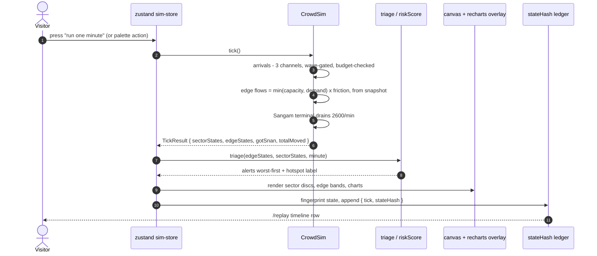
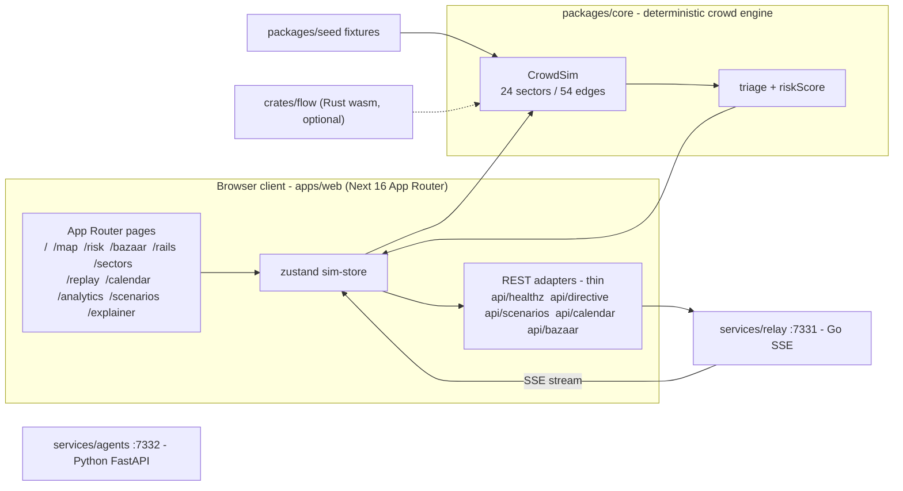

# Diagrams

Mermaid sources for every architectural spot in sangamora. They render
natively on GitHub (no prebuilt SVG involved); `docs/README.md` links here and
the README embeds a couple verbatim when it lands.

## Index

| diagram | purpose |
|---|---|
| `architecture.mmd` | whole-repo flowchart: client, engine, services, seed, wasm |
| `request-flow.mmd` | one tick, end to end: palette → zustand → CrowdSim → triage → canvas |
| `domain-model.mmd` | ER view: waves, trains, sectors, edges, directives, vendors, snapshots |
| `marshal-fsm.mmd` | MarshalBrain state machine: OBSERVE → RANK → ACT → MONITOR |
| `ci-cd.mmd` | push → CI matrix (bun, pytest, cargo, go, loc) → Vercel → optional Docker |
| `user-journey.mmd` | visitor path: landing → explainer → first run → replay → PR |
| `mindmap.mmd` | whole product at a glance: engine, UI, services, docs, ops |
| `gitgraph.mmd` | main ← develop ← feature/* model with `v0.1`, `v0.2` tags |
| `roadmap.mmd` | gantt: M0 shipped core → M4 relay sessions |
| `class-diagram.mmd` | core classes: CrowdSim, SectorGraph, Rng, MarshalBrain, BazaarSim… |
| `metrics-quadrant.mmd` | the eight scenarios on control strength vs compute cost |
| `infra.mmd` | containers and ports for compose: 3000 / 7331 / 7332 + `./.data` |
| `waveforms.mmd` | arrival-rate series over the 7-day window (Shahi bumps + lulls) |
| `economy-loop.mmd` | the bazaar feedback loop and its one-way contract with the swarm |

## Embedded previews

### request-flow.mmd

### architecture.mmd

## Authoring notes

- Theme init (`%%{init:...}%%`) with the saffron palette (`primaryColor`
  `#FF8A00`) sits on every diagram that supports it; keep new diagrams aligned.
- Keep node labels quoted, no raw `<`/`>` characters outside labels, and no
  `:` syntax inside flowchart labels (use `&#58;` or hyphens).
- Do not regenerate these by hand into other formats — a wave-2 docs embed
  consumes `.mmd` sources directly.
